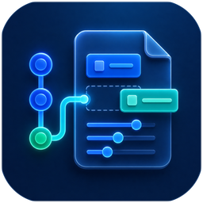
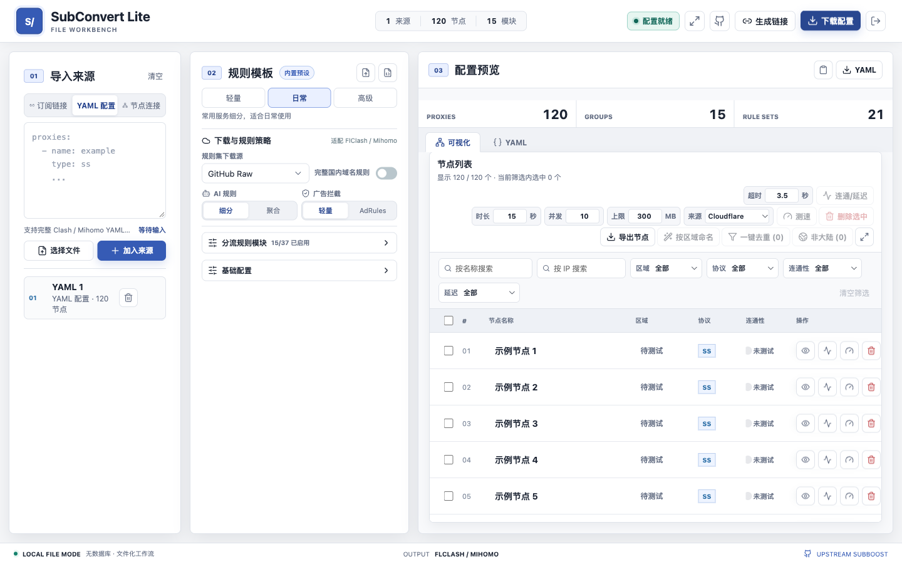

<div align="center">
  

  <h1>SubConvert Lite</h1>

  <p><strong>在浏览器里完成订阅聚合、规则编排、节点实测与 Mihomo 配置生成。</strong></p>
  <p>SubBoost 的本地文件化精简版：无账号、无数据库、无远程后台服务依赖。</p>

  <p>
    
    
    
    
    
  </p>
</div>



## 项目定位

SubConvert Lite 面向只需要“导入节点 -> 选择规则 -> 生成配置”的 FlClash / Mihomo 用户。它保留了 SubBoost 的协议解析和配置生成能力，将工作流收敛到一个宽屏浏览器工作台中。

所有来源和模板状态仅保存在当前浏览器会话内。你可以把模板导出为 JSON，把最终配置下载为 YAML；项目不会创建用户、订阅记录或业务数据库。

## 核心能力

| 能力 | 当前实现 |
| --- | --- |
| 来源导入 | 订阅 URL、Clash / Mihomo YAML、节点分享链接 |
| 批量订阅 | 支持粘贴或多选文本文件追加 URL，默认 10 条并发；进度逐条实时更新，单条 15 秒超时 |
| 证书异常 | 证书过期、主机名不匹配时进入人工审核，可切换 Base64 原文与解码明文 |
| 规则模板 | 轻量、日常、高级三套预设；模块、AI、广告、国内规则均可调整；模板名称由预设自动管理 |
| 模板文件 | `subconvert-template/v1` JSON 导入与导出 |
| 域名直连 | 统一配置域名直连；专用 DNS 可选，不填只生成 `DOMAIN-SUFFIX,...,DIRECT`，填写后额外生成 `fake-ip-filter` 和 `nameserver-policy` |
| 节点管理 | 名称和区域可编辑，支持按出口区域批量命名、按服务器 IP 去重和移除大陆节点 |
| 连通/延迟 | 真实 TCP 与 Mihomo 代理测试，最多 6 个独立 worker 并行，结果逐节点实时显示 |
| 出口区域 | 请求实际经过被测节点，多个公网 IP 服务投票，不根据节点名称或入口 IP 猜测 |
| 下载测速 | Cloudflare、GitHub Release 或自定义 HTTPS 源；实时速度、峰值、平均值和稳定性 |
| 配置预览 | 节点列表可视化预览、YAML 语法高亮、复制与下载 |

## 工作流

```text
订阅 URL / YAML / 节点链接
              |
              v
      解析、去重与人工审核
              |
              v
     节点编辑、连通测试与测速
              |
              v
       选择或自定义规则模板
              |
              v
     可视化预览 -> 下载 YAML
```

### 1. 导入来源

- **订阅链接**：每行一个链接，也可一次选择多个文本文件并按选择顺序追加；默认 10 个 worker 并发执行，来源面板会实时显示已完成、处理中、排队、成功、失败和待审核数量。
- **YAML 配置**：支持粘贴或选择本地 `.yaml` / `.yml` 文件。
- **节点连接**：支持常见的 SS、SSR、VMess、VLESS、Trojan、Hysteria、TUIC、AnyTLS、WireGuard 等格式。

服务端会并行尝试 `v2rayN` 和 `mihomo` User-Agent，以兼容不同订阅端点；必要时再补充浏览器 User-Agent。每条链接取得并发槽后才开始计算 15 秒超时，排队等待不会消耗该链接的超时窗口；单条订阅超时也不会阻塞同批其他链接。

### 2. 设计规则模板

- 使用轻量、日常、高级预设快速开始。
- 模板名称随内置预设自动管理，界面聚焦规则选择，不需要手动维护名称。
- 按核心、服务、社交、媒体、游戏、技术、金融等分类选择规则模块。
- 在页面内菜单中选择 GitHub Raw、jsDelivr、jsDelivr CF 或自定义 URL 前缀作为规则集下载源。
- 选择 AI 规则细分/聚合、轻量/AdRules 广告策略和国内域名增强。
- 在“直连域名”中逐条填写域名；公网站点只填 `baidu.com`，公司内网域名在同一行补充专用 DNS，即可同时生成直连规则和 Fake-IP/DNS 策略。
- 导入或导出 JSON 模板，复用个人规则组合。

当前内置规则主要来自 [MetaCubeX/meta-rules-dat](https://github.com/MetaCubeX/meta-rules-dat)，增强广告规则可选用 [AdRules](https://adrules.top/)。

### 3. 测试节点

连通/延迟测试分为三层：

1. 对节点入口执行真实 DNS 与 TCP 建连检查。
2. 启动隔离的临时 Mihomo 实例，通过目标节点访问延迟测试地址。
3. 通过该节点查询真实出口 IP，多服务投票后更新区域。

连通/延迟最多使用 6 个独立 Mihomo worker 并行执行。每个节点完成后会立即通过 NDJSON 流推送到页面，因此慢节点不会挡住已经完成的结果。

下载测速与延迟测试分开执行，避免误操作消耗大量流量：

- 每批最多选择 5 个节点。
- 单节点下载并发可设置为 `1-100`，默认 `10`。
- 测速窗口可设置为 `15-300` 秒。
- 稳态采样上限可设置为 `50-2048 MB`。
- 下载内容只在内存流中计数并丢弃，**不会保存到磁盘**。

> 节点测速会产生真实网络流量。高并发和较大的采样上限可能迅速消耗订阅流量及本机带宽。

## 快速开始

### 环境要求

- macOS arm64 或 x64
- Node.js `>=22.13.0 <23` 或 `>=24.0.0`
- npm（使用仓库中的 `package-lock.json`）

首次执行节点测试时，应用会下载并校验适用于当前 Mac 的 Mihomo 内核，缓存到 `apps/web/data/mihomo/`。

```zsh
git clone https://github.com/lonnnnnng/subboost-lite.git
cd subboost-lite
npm ci
npm run dev
```

浏览器打开 [http://127.0.0.1:3010](http://127.0.0.1:3010)。

### 生产模式

```zsh
npm run build
npm --workspace @subconvert/web run start
```

### 使用外部 Mihomo 内核

非 macOS 环境不会自动下载内核，但可以显式指定兼容当前系统的可执行文件：

```zsh
SUBCONVERT_MIHOMO_PATH=/absolute/path/to/mihomo npm run dev
```

也可以使用 `SUBCONVERT_MIHOMO_DIR` 修改自动下载内核的缓存目录。

## 安全与隐私

- 节点测试 API 只接受本机同源页面请求。
- 订阅抓取会校验公网目标并固定已核验 IP，重定向后会重新检查，降低 SSRF 与 DNS rebinding 风险。
- 默认严格验证 TLS。只有证书错误且返回内容确实能解析出节点时，才允许用户在弹窗中人工决定是否加入。
- 忽略证书错误不会把站点变得可信；审核前应检查 URL、节点内容和订阅来源。
- 订阅内容、节点列表和模板不会写入业务数据库，也不会自动上传到第三方服务。
- Mihomo 内核及其版本元数据属于本地工具缓存，不包含订阅内容。

## 项目结构

```text
subboost-lite/
├── apps/web/                   # Next.js 浏览器工作台与本地 API
│   ├── app/api/import/         # 订阅抓取、证书异常审核候选
│   ├── app/api/node-test/      # 流式节点测试接口
│   └── src/lib/node-test/      # TCP、Mihomo、出口地区与测速实现
├── packages/core/              # 协议解析、规则模块、配置与 YAML 生成
├── packages/server-core/       # 订阅导入、兼容性与安全校验
└── docs/assets/                # README 图片资源
```

## 开发检查

```zsh
npm run typecheck
npm run lint
npx vitest run apps/web
npm run build
```

根目录的 `npm test` 当前执行 TypeScript 检查与生产构建。

## 与完整 SubBoost 的区别

此项目刻意移除了：

- 用户、登录和权限系统
- Prisma 及业务数据库
- 已保存订阅、访问 Token 和定时刷新
- 管理后台、模板广场及服务端模板存储
- 桌面客户端封装

如果需要多用户、持久化订阅或在线服务能力，请使用上游 [SubBoost](https://github.com/SubBoost/subboost)。

## License

项目基于 SubBoost 的核心代码精简而来，继续遵循 [GNU AGPL-3.0-only](LICENSE)。
